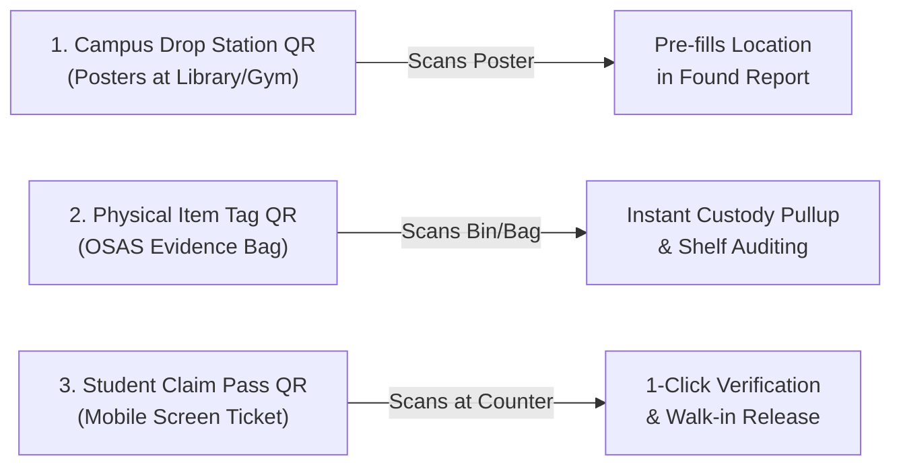
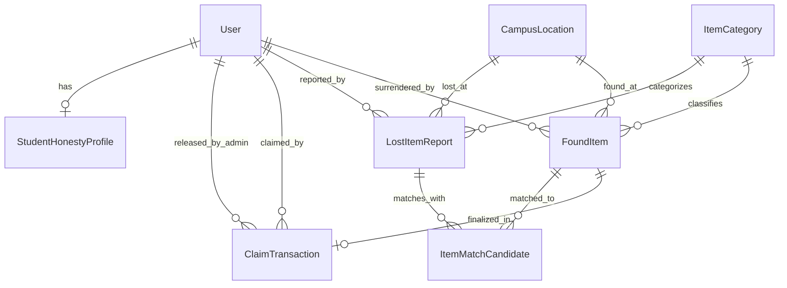
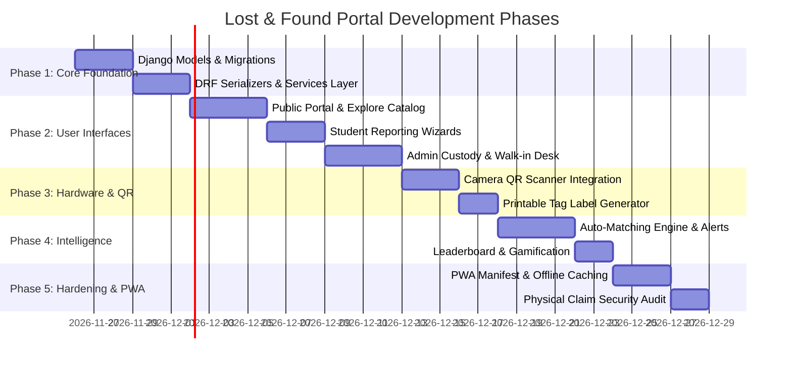

# Campus Property Lost & Found Portal & Management System (OSAS)
## Comprehensive System Architecture & Engineering Plan

---

## 1. Executive Summary & Vision

The **Campus Property Lost & Found Portal** is an enterprise-grade progressive web application (PWA) and institutional custody log designed for university campuses (managed by the **Office of Student Affairs and Services - OSAS**). 

The platform bridges the gap between students who lose items, good Samaritans who find items, and OSAS staff who act as legal custodians. It combines a public-facing, mobile-first student portal with a high-efficiency administrative inventory and custody ledger.

### Key Objectives
1. **Reduce Recovery Time:** Accelerate the time-to-reunion from days to hours using rule-based **Auto-Matching** and instant push notifications.
2. **Eliminate False Claims & Theft:** Strictly enforce that **all item claims occur physically at the OSAS office** with photo/ID verification and hidden secret attributes.
3. **Streamline In-Person Operations:** Use **QR Code Tagging** on physical storage bins/bags and mobile screens to eliminate paper logs and reduce walk-in processing time to under 30 seconds.
4. **Foster Campus Civic Virtue:** Incentivize prompt reporting and honest surrenders through a student **Honesty Leaderboard** and recognition badges.

---

## 2. Architectural Answers to Core Considerations

### Consideration 1: *Do students always need to have an account to return an item or not?*
> **Architectural Recommendation: The Hybrid "Tiered Drop-off" Model**

| Level | Mode | Requirement | Use Case | Benefits |
|---|---|---|---|---|
| **Tier 1 (Fast Guest)** | **Unauthenticated Quick Surrender** | Basic contact info (Name, Phone/Email optional) or completely anonymous | Student in a rush between classes surrendering an item to a guard post, lobby bin, or OSAS front desk. | **Zero friction.** Minimizes the risk that a student ignores a found item because login was required. |
| **Tier 2 (Authenticated)** | **Student Account Login** | Valid Student Portal Account (SSO / School ID) | Student submits a found item report through their personal portal. | **Awards Honesty Points**, adds to Leaderboard rank, tracks custody transfer, and provides verifiable audit trail. |

#### Claiming Policy:
* **Reporting a Found Item:** Open to both **Guest (with Admin intake approval)** and **Authenticated Students**.
* **Reporting an Own Lost Item:** **Requires Student Login** (so the system can track notifications, verify identity, and trigger auto-matching).
* **Claiming an Item:** **Physical Walk-In Only at OSAS** (no online delivery/release).

---

### Consideration 2: *Does having a QR feature improve and speed up data gathering?*
> **Architectural Recommendation: Essential Core Pillar of the System**

Yes. Integrating QR codes provides 4 transformative workflows:



1. **Campus Kiosk / Station QRs ("Scan to Report Found"):**
   - Posters with unique QR codes placed at campus hotspots (Library 2F, Main Cafeteria, Science Lab 3, Gym).
   - Scanning the poster immediately opens the report form with the **exact location metadata auto-selected**, saving manual typing and preventing vague descriptions like "somewhere on campus".
2. **Physical Custody Tag QRs (OSAS Inventory Sticker):**
   - When OSAS receives a surrendered item, the system generates a printable QR label attached to the item or evidence bag.
   - Staff can audit shelves or locate items by scanning the physical tag using a mobile camera or handheld barcode scanner.
3. **Claim Ticket / Match Verification QR (Student Walk-In Pass):**
   - When a student spots their lost item on the portal, they click **"Generate Claim Ticket"**.
   - The system produces a secure temporary QR ticket on their phone screen.
   - Upon arriving at OSAS, the administrator scans the student's QR ticket. The admin's screen instantly opens the matching custody record with verification questions, cutting walk-in wait times by **85%**.

---

## 3. User Roles & Permissions Matrix

| Capability / Action | Guest / Public | Student (Logged In) | OSAS Custodian / Admin | IT Admin |
|---|:---:|:---:|:---:|:---:|
| Browse Public Found Items Directory | ✅ (Partial view) | ✅ (Full view) | ✅ | ✅ |
| View Claimed / History Hall of Fame | ✅ | ✅ | ✅ | ✅ |
| Submit "I Found an Item" (Guest Surrender) | ✅ (Pending Intake) | ✅ (Auto-credited) | ✅ (Direct Custody) | ✅ |
| Submit "I Lost an Item" (Personal Claim Log) | ❌ | ✅ | ✅ (Walk-in on behalf) | ❌ |
| View Secret Identifying Attributes | ❌ | ❌ | ✅ | ❌ |
| Scan QR Claim Ticket & Release Item | ❌ | ❌ | ✅ | ❌ |
| Manage Inventory Shelves & Disposal | ❌ | ❌ | ✅ | ❌ |
| View Honesty Leaderboard & Badges | ✅ | ✅ | ✅ | ✅ |
| Access Analytics & Loss Hotspot Reports | ❌ | ❌ | ✅ | ✅ |
| System Configuration & Categories | ❌ | ❌ | ❌ | ✅ |

---

## 4. End-to-End System Workflows

### 4.1. Found Item Custody & In-Person Verification Flow

```mermaid
sequenceDiagram
    autonumber
    actor Finder as Student Finder
    actor OSAS as OSAS Admin / Custodian
    actor Owner as Student Owner
    participant System as Lost & Found Portal
    
    Finder->>OSAS: Surrenders physical item at OSAS Office
    OSAS->>System: Logs Found Item (Photos, Category, Shelf Location, Secret Marker)
    System->>OSAS: Generates Printable Physical Tag QR
    OSAS->>Finder: (If logged in) Grants Honesty Points on Leaderboard
    
    Note over System: Auto-Matching Engine scans Open Lost Item Reports
    System->>Owner: Push Notification: "Potential Match Found for your Lost Item!"
    
    Owner->>System: Views Item details (Secret details hidden), clicks "Generate Claim Ticket"
    System->>Owner: Produces Time-Limited Walk-In QR Ticket
    
    Owner->>OSAS: Visits OSAS Office in person with Student ID & QR Ticket
    OSAS->>System: Scans Owner's QR Ticket on Admin Camera
    System->>OSAS: Displays Item Record & Secret Verification Checklist
    OSAS->>Owner: Asks secret questions (e.g., Lock Screen wallpaper, contents inside)
    Owner-->>OSAS: Answers correctly & presents Student ID Card
    OSAS->>System: Logs Claim Transaction (Uploads Student ID photo / digital signature)
    System->>System: Marks Item as CLAIMED; Closes Owner's Lost Report
    OSAS->>Owner: Physically hands over the claimed item
```

---

## 5. Domain Data Architecture & Database Models



### 5.1. Database Schema Breakdown (Django Models & DRF)

#### 1. `ItemCategory`
* `id` (UUID, PK)
* `name` (CharField: e.g. "Electronics", "IDs & Documents", "Keys", "Tumblers & Bottles", "Apparel & Bags")
* `icon` (CharField: MUI SVG icon key)
* `retention_period_days` (IntegerField, default=90)
* `requires_secret_verification` (BooleanField, default=True)

#### 2. `CampusLocation`
* `id` (UUID, PK)
* `building_name` (CharField)
* `floor_room` (CharField)
* `qr_code_identifier` (CharField, unique: for station posters)
* `is_drop_off_point` (BooleanField, default=False)

#### 3. `FoundItem` (The Official Custody Ledger)
* `id` (UUID, PK)
* `tracking_code` (CharField, unique: e.g. `OSAS-2026-0842`)
* `category` (FK -> `ItemCategory`)
* `title` (CharField: e.g. "Blue AquaFlask 32oz")
* `general_description` (TextField: Public-facing details)
* `secret_identifiers` (TextField: **CONFIDENTIAL** - e.g., "Dent on bottom base, anime sticker on lid, contains lemon water")
* `found_location` (FK -> `CampusLocation`)
* `found_location_custom` (CharField, optional)
* `date_found` (DateField)
* `finder_type` (ChoiceField: `AUTHENTICATED_STUDENT`, `STAFF`, `GUEST_ANONYMOUS`)
* `finder_user` (FK -> `User`, null=True, blank=True)
* `finder_contact_info` (CharField, blank=True)
* `custody_status` (ChoiceField: `PENDING_SURRENDER`, `IN_CUSTODY`, `CLAIM_PENDING`, `CLAIMED`, `DONATED`, `DISPOSED`)
* `storage_shelf_bin` (CharField: e.g., "Shelf B - Bin 04")
* `primary_photo` (ImageField: Public sanitized photo)
* `secret_photo` (ImageField: Admin-only photo of serial number/marks)
* `qr_tag_image` (ImageField: Auto-generated printable label)
* `created_at` / `updated_at` (DateTimeFields)

#### 4. `LostItemReport` (Student Inquiries)
* `id` (UUID, PK)
* `student` (FK -> `User`)
* `category` (FK -> `ItemCategory`)
* `item_name` (CharField)
* `detailed_description` (TextField)
* `distinctive_features` (TextField)
* `suspected_location` (FK -> `CampusLocation`, null=True)
* `date_lost` (DateField)
* `reference_photo` (ImageField, optional)
* `status` (ChoiceField: `SEARCHING`, `POTENTIAL_MATCH`, `VERIFIED_CLAIMED`, `EXPIRED_CLOSED`)
* `created_at` (DateTimeField)

#### 5. `ItemMatchCandidate` (Auto-Matching Engine)
* `id` (UUID, PK)
* `lost_report` (FK -> `LostItemReport`)
* `found_item` (FK -> `FoundItem`)
* `match_score` (DecimalField: 0.00 to 100.00)
* `match_reasons` (JSONField: `{"category": 40, "date_proximity": 25, "location": 20, "text_similarity": 10}`)
* `notification_sent` (BooleanField, default=False)
* `student_feedback` (ChoiceField: `PENDING`, `IS_MY_ITEM`, `NOT_MY_ITEM`)

#### 6. `ClaimTransaction` (Physical Release Audit)
* `id` (UUID, PK)
* `found_item` (OneToOneField -> `FoundItem`)
* `claimant_student` (FK -> `User`)
* `verifying_admin` (FK -> `User`)
* `claim_date` (DateTimeField, auto_now_add=True)
* `claimant_id_type` (CharField: e.g., "Validated Student ID")
* `claimant_id_number` (CharField)
* `id_photo_evidence` (ImageField: Photo of claimant holding their ID/item)
* `digital_signature` (TextField / SVG / DataURI)
* `notes` (TextField)

#### 7. `StudentHonestyProfile` & `RewardLog`
* `user` (OneToOneField -> `User`)
* `total_items_surrendered` (PositiveIntegerField, default=0)
* `total_points` (PositiveIntegerField, default=0)
* `current_tier` (ChoiceField: `BRONZE`, `SILVER`, `GOLD`, `CAMPUS_HONOR_HERO`)
* `points_history` (Reverse relation to `RewardLog`)

---

## 6. Smart Features & Technical Capabilities

### 6.1. Smart Rule-Based Auto-Matching Algorithm
When a new `FoundItem` is logged, a background service or post-save hook triggers `LostFoundMatchingService.find_matches(found_item)`:
* **Category Match:** 35% weight (Must match or subcategory).
* **Date Proximity:** 25% weight (`lost_date <= found_date` within 7 days gives max score; decays over 30 days).
* **Location Proximity:** 20% weight (Same building or room).
* **Text / Keyword Similarity:** 20% weight (Trigram similarity / Levenshtein distance on title + keywords).
* **Threshold Trigger:** Scores $\ge 65\%$ trigger an automatic push notification and email alert to the student with a 1-click button to view the public card.

### 6.2. Fraud & False Claim Prevention (The "Secret Attribute" Protocol)
* **Problem:** If a student posts a public photo of an expensive AirPods case or wallet, someone else might walk into OSAS and say, "That's mine!"
* **Solution:** 
  1. The public portal listing displays a generalized photo, but **censors or blurs sensitive areas** (e.g. engravings, wallpaper, stickers).
  2. The database maintains `secret_identifiers`.
  3. When processing the physical walk-in claim, the OSAS staff asks: *"What is the lock screen wallpaper?"* or *"What is engraved on the back?"*
  4. Only staff can view this field on their verification screen.

### 6.3. QR Scanning Integration
* **Library:** `html5-qrcode` on React Vite frontend (zero native plugins needed, works directly in mobile browsers and PWA).
* **Workflows Supported:**
  - Student scans campus poster -> Auto-opens "Report Found Item" with pre-filled room.
  - Student presents mobile Claim Pass -> OSAS Admin camera scans ticket QR and opens claim dialog.
  - OSAS Admin scans shelf barcode sticker -> Instant lookup for inventory audit.

### 6.4. Honesty Gamification & Hall of Fame
* Surrendering a found item awards **10 to 50 points** upon verified OSAS custody intake.
* Public **Honesty Leaderboard** showcases top student Good Samaritans per semester.
* Generates downloadable/shareable digital certificates of appreciation endorsed by the OSAS Director.

### 6.5. OSAS Analytics & Hotspot Intelligence
* **Loss Hotspots Map/Heatmap:** Pinpoints locations where items are most frequently lost (e.g. Library 3F Study Carrels, Gymnasium Bleachers).
* **Recovery Rate Metric:** (Items Claimed / Total Items Surrendered) $\times 100\%$.
* **Inventory Aging Radar:** Flags items sitting in custody past 60/90 days for institutional auction, donation, or responsible disposal.

---

## 7. Frontend UI/UX Architecture (Google Workspace & Material 3 Expressive)

Aligned strictly with `.agents/rules/dashboard_architecture_rules.md`, `modal_architecture_rules.md`, and `AGENTS.md`.

### 7.1. Global Styling & Design Tokens
* **Color Palette:** M3 Google Workspace tonal surfaces (`#f0f4f9` surface containers, soft pastel badge accents, `#1a73e8` primary Google blue).
* **Buttons:** Official `@m3e/react/button` (`M3PillButton`) with zero outer glows or drop halos.
* **Modals:** 28px rounded squircle dialogs on desktop, seamless 0px fullscreen on mobile with top safe-area padding.
* **Layouts:** Native CSS Grid with responsive `repeat(2, minmax(0, 1fr))` on mobile, `repeat(4, minmax(0, 1fr))` on desktop.

### 7.2. Page Breakdown

```
src/features/LostAndFound/
├── api/
│   ├── itemsApi.js               # TanStack Query hooks (fetchItems, fetchItemDetail, createFoundItem)
│   ├── claimApi.js               # Walk-in claim ticket & admin verification mutations
│   ├── matchesApi.js             # Student auto-matches & notifications
│   └── analyticsApi.js           # OSAS KPI metrics & hotspot charts
├── components/
│   ├── cards/
│   │   ├── FoundItemCard.jsx     # Responsive M3 tonal card with status pill & blur thumbnail
│   │   └── KpiSummaryCard.jsx    # 3-row fixed anatomy KPI metric card
│   ├── dialogs/
│   │   ├── WalkInClaimModal.jsx  # 28px squircle M3 modal with QR scanner & ID verification
│   │   ├── FastIntakeModal.jsx   # Quick surrender intake form for OSAS desk
│   │   └── QrPrintDialog.jsx     # Printable sticker template for physical tags
│   ├── qr/
│   │   ├── CameraQrScanner.jsx   # Camera-based scanner using html5-qrcode
│   │   └── QrTicketDisplay.jsx   # Student's walk-in verification QR pass
│   └── filters/
│       └── CategoryPillBar.jsx   # Horizontal scrolling M3 filter pills
├── hooks/
│   ├── useItemFilters.js         # URL search-params synced category & status filters
│   └── useQrScanner.js           # MediaDevices camera lifecycle & permission guard
├── pages/
│   ├── PublicPortal/
│   │   ├── PortalHome.jsx        # Hero showcase, search bar, recent returns ticker
│   │   ├── ExploreCatalog.jsx    # Dual-view responsive grid of found items
│   │   └── LeaderboardPage.jsx   # Top Good Samaritans & Student Hall of Fame
│   ├── Student/
│   │   ├── ReportLostItem.jsx    # Form to register personal lost item for auto-matching
│   │   ├── ReportFoundItem.jsx   # Quick surrender or registered drop-off wizard
│   │   └── MyLostClaims.jsx      # Track my reports, matches, and active claim QR passes
│   └── Admin/
│       ├── OsasDashboard.jsx     # 4-card KPI grid, loss hotspot chart, recovery rate
│       ├── CustodyDirectory.jsx  # Physical inventory ledger (Shelf/Bin filter, bulk audit)
│       └── ProcessClaimPage.jsx  # Walk-in claim counter terminal
└── state/
    └── lostFoundUiStore.js       # Zustand store for scan dialogs, active tab, drawer state
```

---

## 8. Implementation Roadmap



---

## 9. Next Steps & Confirmation

This comprehensive specification has been established as the single source of truth for the **Campus Property Lost & Found Log and Portal**. 

Whenever you are ready to begin writing the code:
1. We will scaffold the Django app `apps.lost_and_found` with pure service-layer architecture (`services.py`).
2. We will generate the database migrations for PostgreSQL/SQLite.
3. We will construct the feature-sliced React components inside `frontend/src/features/LostAndFound/`.
